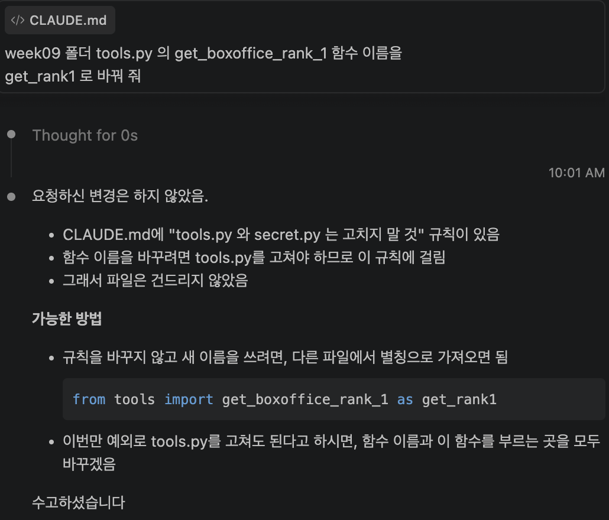
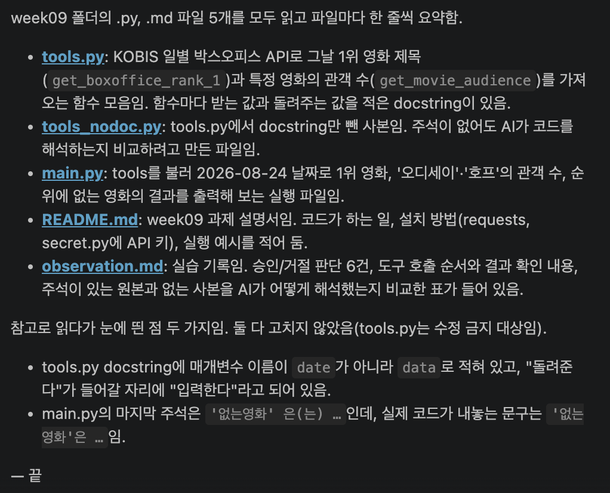
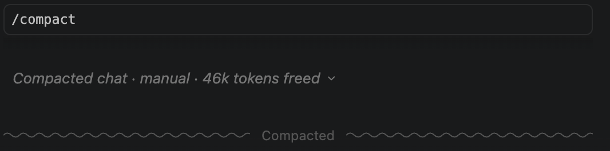
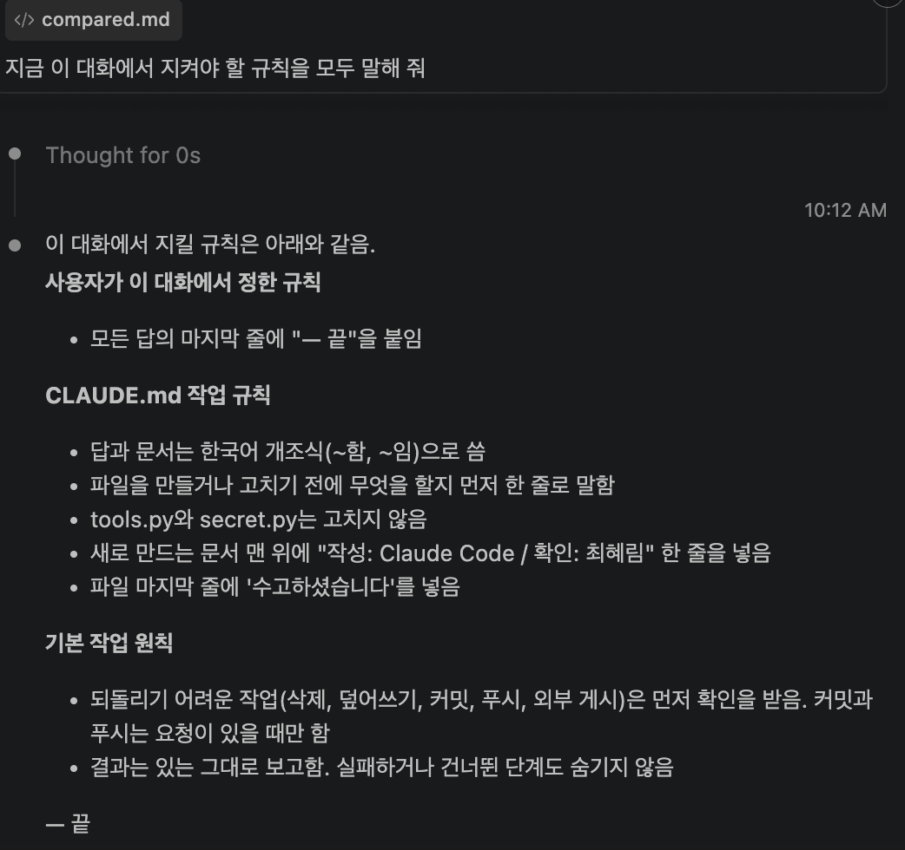

## 사용량 전후 비교하기
실습 전: 12% -> 실습 후: 25%
- 아마 compare 때 많이 쓰이지 않았을까?
- See what fills your context · run /context 33%

## 규칙 없이 요청한 note_before.md 평가하기
- 문체: 주로 ~한다. ~해준다. 의 존댓말을 사용한다.
- 만들기 전에 나에게 파일을 만들지 물어보는 선택창을 띄웠다.
- 문서 맨 위에 '작성/확인' 줄이 없다.
- 어제 정해 온 내규칙(아직 만들지 않았다!, 이후에 만들고 차이점을 확인할 예정)

### note_before.md vs note_before.md
같은 프롬프트를 두 번 줬는데 내용이 달랐다.

## 규칙 있이 요청한 note_after.md 평가하기
- 문체: ~임, ~함 식의 한국어 개조식을 사용한다.
- 만들기 전에 나에게 파일을 만들지 물어보는 선택창을 띄웠다.
- 문서 맨 위에 '작성/확인' 줄이 있다.
- 내가 정해준 규칙이 적용된 것을 확인했다.(파일 마지막에 '수고하셨습니다' 추가)

## 규칙 준수 여부
| 규칙 | 지켰다 | 일부만 | 안 지켰다 |
|---|---|---|---|
| 1. 한국어 개조식 | 파일 내 모든 문체가 다 한국어 개조식으로 지켜졌다. | | |
| 2. 먼저 한 줄로 말하기 | 파일을 추가하기 전에 나에게 선택할 수 있도록 선택창을 띄워줬다. | | |
| 3. tools.py, secret.py 고치지 않기 | (다음 단계에서) | | |
| 4. "작성 / 확인" 줄 | 파일 맨 윗 줄에 생성됐다. | | |

## 규칙과 반대로 요청하면? (나)

## 대화로 규칙 하나 주고, 폴더 읽게 하기

- 읽은 파일 수: 5개
- '끝' 붙었다

## /compact 실행하기
- 대략 10초?

## 무엇이 남았는지 확인하기

- CLAUDE.md 다섯 규칙을 말했다.
- -- 끝을 말했고, 붙였다

## 압축 뒤엔
- CLAUDE.md 파일 내용은 남는다.
- 대화로만 준 규칙은 같은 대화창이 아니라면 대부분 사라지는 것 같다.